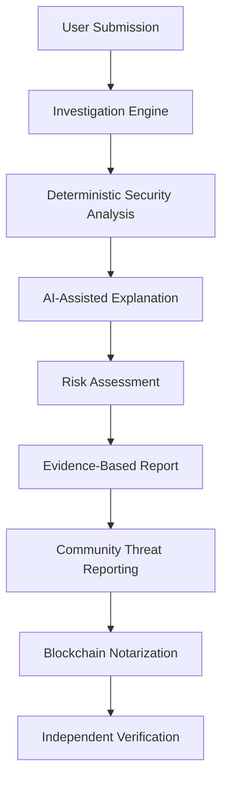
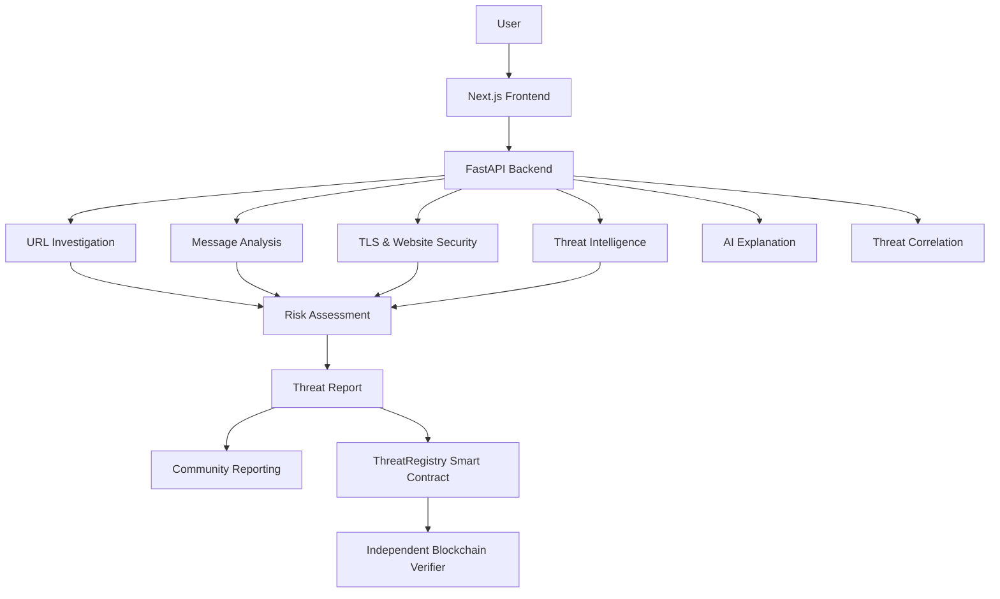

# 🛡️ AstraNexus
### AI-Powered Digital Trust, Threat Intelligence & Blockchain Verification

**Identify digital threats. Understand the evidence. Verify what matters.**

AstraNexus is an AI-powered digital trust and cybersecurity intelligence platform designed to help individuals identify suspicious websites, recognize online scams, investigate potential phishing attacks, and verify the integrity of reported threats.

It brings together three complementary technologies:

- **Cybersecurity** — Technical investigation of URLs, domains, TLS certificates, and suspicious indicators.
- **Artificial Intelligence** — Contextual scam analysis and understandable, evidence-grounded explanations.
- **Blockchain** — Tamper-evident threat report records with independent integrity verification.

Our goal is to make digital safety more accessible by helping people understand potential threats before they become victims.

---

## 📌 Table of Contents

1. [The Problem](#-the-problem)
2. [Our Solution](#-our-solution)
3. [How AstraNexus Works](#-how-astra-nexus-works)
4. [Core Features](#-core-features)
5. [Risk Classification](#-risk-classification)
6. [AI and Explainability](#-ai-and-explainability)
7. [Blockchain Threat Notary](#-blockchain-threat-notary)
8. [System Architecture](#-system-architecture)
9. [Technology Stack](#-technology-stack)
10. [Hackathon Problem Statement Alignment](#-hackathon-problem-statement-alignment)
11. [Testing and Validation](#-testing-and-validation)
12. [Getting Started](#-getting-started)
13. [Environment Configuration](#-environment-configuration)
14. [Security and Privacy](#-security-and-privacy)
15. [Known Limitations](#-known-limitations)
16. [Future Roadmap](#-future-roadmap)
17. [Documentation](#-documentation)

---

## 🔍 The Problem

Digital scams are becoming increasingly sophisticated.

Phishing websites imitate legitimate brands. Fraudulent job offers promise unrealistic earnings. Fake banking messages create urgency to steal credentials. Malicious actors exploit people's trust in familiar companies and online services.

For ordinary internet users, identifying these threats is difficult.

A suspicious link may look legitimate. A fraudulent message may appear professionally written. Even a website using HTTPS is not necessarily trustworthy.

Existing security tools can also be difficult for non-technical users to understand.

People need more than a simple safe-or-unsafe label. They need to understand:

- What makes a website suspicious?
- Are there technical weaknesses in its security configuration?
- Does a message contain signs of social engineering?
- What evidence supports the assessment?
- What should they do next?
- Can a submitted threat report be independently verified?

## 💡 Our Solution

AstraNexus provides an accessible investigation platform that combines deterministic cybersecurity checks, AI-assisted explanations, threat intelligence, and blockchain-based report integrity.

Users can:

- Investigate suspicious URLs and domains.
- Inspect TLS certificates and website security configurations.
- Analyse suspicious SMS messages, emails, and job offers.
- Understand identified phishing and social engineering indicators.
- Explore related community threat reports.
- Submit suspicious incidents for review.
- Verify the integrity of registered threat reports independently.

Rather than relying on AI alone, AstraNexus uses deterministic security analysis to establish findings and uses AI to help explain them in understandable language.

---

## ⚙️ How AstraNexus Works

AstraNexus follows a six-stage investigation workflow.



### 1. Submit

The user submits a suspicious URL, domain, message, or email content.

### 2. Investigate

The platform collects available technical information, including domain structure, DNS records, TLS certificate information, website security indicators, and external threat intelligence matches.

### 3. Analyse

Deterministic security engines evaluate suspicious indicators.

The AI explanation layer provides contextual information about the findings without independently overriding the security verdict.

### 4. Assess

A structured risk classification is generated using available evidence.

### 5. Report

Users can submit relevant incidents to the community reporting system.

### 6. Verify

A cryptographic commitment of a threat report can be registered on an EVM-compatible blockchain.

An independent verifier can subsequently check whether the report matches its registered commitment.

---

## 🚀 Core Features

### 1. Multi-Layer URL Investigation

AstraNexus evaluates submitted URLs using multiple security checks.

**Domain and URL Analysis**

- Public Suffix List-based domain extraction.
- Brand impersonation and combosquatting detection.
- Levenshtein-distance-based lookalike detection.
- Suspicious subdomain and URL pattern analysis.
- Punycode and internationalized domain name inspection.
- Suspicious authentication and credential-harvesting patterns.

**DNS Reconnaissance**

- A record resolution.
- AAAA record resolution.
- MX record inspection.
- NS record inspection.
- TXT record inspection.
- Graceful handling of unavailable DNS information.

**SSRF Defense Shield**

The URL inspection system incorporates protections against requests to:

- Private IPv4 networks.
- Loopback addresses.
- Cloud metadata endpoints.
- Restricted internal destinations.

Redirect destinations are also subject to security validation.

### 2. TLS Certificate and Website Security Analysis

HTTPS does not automatically mean a website is trustworthy.

AstraNexus performs passive TLS and website security inspection to identify relevant configuration and certificate issues.

**TLS inspection includes:**

- Certificate expiration.
- Hostname and SAN matching.
- Certificate issuer information.
- Certificate validity period.
- Cryptographic public-key information.
- Signature algorithm information.
- TLS protocol information.
- Available Certificate Transparency information.

**Website security assessment includes:**

- Content Security Policy (CSP).
- HTTP Strict Transport Security (HSTS).
- X-Content-Type-Options.
- Referrer-Policy.
- X-Frame-Options.
- Redirect downgrade indicators.
- Mixed-content indicators.

Unavailable checks are reported as unavailable rather than silently treated as successful.

### 3. AI-Powered Scam Message Analysis

Users can submit suspicious messages or email content for analysis.

AstraNexus identifies patterns associated with nine threat categories:

| Category | Examples |
|---|---|
| Banking Impersonation | Fake KYC requests and account-blocking threats |
| Fake Job Offers | Registration fees and fraudulent recruitment |
| Crypto and Investment Scams | Unrealistic guaranteed returns |
| Lottery and Sweepstakes | Fake prize claims and processing fees |
| Postal Redelivery | Fake parcel delivery and address-update requests |
| Utility Extortion | Fraudulent electricity or service disconnection threats |
| Credential Harvesting | Requests for passwords and account verification |
| Suspicious Links | Deceptive URLs and suspicious domains |
| Social Engineering | Manipulation, impersonation, and deceptive requests |

**Additional capabilities:**

- URL and domain extraction.
- Email and phone-number extraction.
- Payment indicator identification.
- Cryptocurrency wallet and gift-card indicator detection.
- Credit card, OTP, and password redaction.
- Prompt injection detection.
- Contextual scam explanations.

AstraNexus does not classify a message as fraudulent merely because it contains urgent language. Context and supporting indicators matter.

### 4. Threat Intelligence and Correlation

AstraNexus combines available external threat intelligence with community reporting and similarity analysis.

**Threat intelligence integrations include:**

- Abuse.ch URLhaus.
- OpenPhish.
- Google Safe Browsing.

Additional threat intelligence integrations may be available depending on configured credentials and provider availability.

**Threat correlation capabilities:**

- Exact indicator matching.
- Domain and infrastructure similarity.
- Semantic message similarity.
- Shared scam techniques.
- Related incident discovery.

Community metrics distinguish between:

- Similar Reports Count.
- Unique Reporters Count.
- Confirmed Incidents Count.

Reports awaiting review are not automatically treated as confirmed malicious incidents.

### 5. Consumer Security Advisories

AstraNexus provides consumer-facing security advisories from recognized public sources, including:

- Federal Trade Commission (FTC).
- Cybersecurity and Infrastructure Security Agency (CISA).
- FBI Internet Crime Complaint Center (IC3).
- United States Postal Inspection Service (USPIS).

Advisory availability depends on the source and its accessibility.

---

## 🎯 Risk Classification

AstraNexus uses a consistent five-level risk classification system.

| Classification | Description |
|---|---|
| 🟢 **Low Risk** | No significant malicious indicators identified within the available checks |
| 🟡 **Suspicious** | One or more indicators require further investigation |
| 🟠 **High Risk** | Multiple significant indicators suggest a substantial security threat |
| 🔴 **Confirmed Malicious** | Supported by authoritative threat intelligence or sufficiently validated evidence |
| ⚪ **Inconclusive** | Insufficient data or unavailable verification sources |

Each assessment is designed to provide:

- Overall risk classification.
- Identified threat indicators.
- Supporting technical evidence.
- Relevant information sources.
- Analysis timestamp.
- Confidence or evidence coverage.
- Recommended precautions.
- Limitations and unavailable checks.

**Important:** The absence of a threat intelligence match does not establish that a website is safe.

---

## 🧠 AI and Explainability

AstraNexus uses AI as an explanatory and contextual analysis layer.

Its approach separates security decision-making from natural-language explanation.

### Deterministic Security Analysis

The security engines evaluate technical and behavioural indicators and establish the underlying findings.

### AI-Assisted Explanation

The AI layer helps users understand:

- Why a URL was flagged.
- What suspicious patterns were identified.
- Why a message may be fraudulent.
- What the available evidence means.
- What precautions users should take.

### Prompt Injection Protection

Submitted messages and retrieved content are treated as untrusted input.

Instructions embedded in submitted content must not override the security analysis or manipulate its final verdict.

The objective is to make cybersecurity findings understandable without allowing an AI-generated explanation to replace evidence.

---

## ⛓️ Blockchain Threat Notary

AstraNexus integrates an EVM-compatible smart contract named `ThreatRegistry.sol`.

Its purpose is to establish tamper-evident records of submitted threat reports.

### How It Works

1. A threat report is prepared in a canonical format.
2. A cryptographic commitment is generated.
3. The commitment is registered through the smart contract.
4. The blockchain transaction provides a verifiable reference.
5. An independent verification tool queries the blockchain.
6. The submitted report is checked against its registered commitment.

### Key Capabilities

- Cryptographic report commitments.
- On-chain threat report registration.
- Revision records.
- Dispute records.
- Transaction references.
- Independent JSON-RPC verification.
- Tamper detection.

### Zero-PII On-Chain Approach

Raw URLs, email addresses, phone numbers, passwords, and private user information are not stored directly on-chain.

The blockchain stores cryptographic commitment information and associated registry metadata.

### Independent Verification

AstraNexus includes a standalone verification tool:

`tools/verify_report_standalone.py`

It can query the EVM network directly through JSON-RPC without depending on the AstraNexus backend.

This allows a report's integrity to be checked independently.

**Blockchain integrity is not proof of factual truth.**

A valid blockchain commitment establishes that the submitted data matches a registered record. It does not independently establish that the original accusation is correct.

### Network Information

The current reproducible demonstration uses a local Hardhat EVM network:

- Network: Local Hardhat
- Chain ID: `31337`
- RPC: `http://127.0.0.1:8545`

This is a local development environment, not a public Ethereum mainnet or public testnet deployment.

---

## 🏗️ System Architecture

AstraNexus uses a modular architecture.



### Repository Structure

```text
AstraNexus/
│
├── backend/
│   ├── app/
│   │   ├── api/
│   │   │   └── v1/
│   │   │       └── endpoints/
│   │   ├── core/
│   │   ├── schemas/
│   │   └── services/
│   │
│   ├── tests/
│   └── requirements.txt
│
├── frontend/
│   ├── src/
│   │   └── app/
│   └── public/
│
├── blockchain/
│   ├── contracts/
│   │   └── ThreatRegistry.sol
│   ├── test/
│   └── hardhat.config.js
│
├── tools/
│   ├── verify_report_standalone.py
│   ├── audit_suite.py
│   └── run_six_regression_tests.py
│
├── documentation/
│
├── pytest.ini
└── README.md
```

---

## 💻 Technology Stack

| Component | Technologies |
|---|---|
| Frontend | Next.js, React, TypeScript |
| Styling | Tailwind CSS |
| Backend | Python, FastAPI |
| Data Validation | Pydantic |
| AI | Gemini API |
| Domain Intelligence | Public Suffix List, DNS inspection |
| TLS Analysis | Python SSL and socket inspection |
| Threat Intelligence | URLhaus, OpenPhish, Google Safe Browsing |
| Smart Contracts | Solidity |
| Blockchain Development | Hardhat, EVM |
| Blockchain Verification | JSON-RPC, cryptographic commitments |
| Testing | Pytest, Hardhat tests |

---

## 🏆 Hackathon Problem Statement Alignment

AstraNexus was developed for the challenge:

**AI-Powered Web Threat Detection & Digital Trust Intelligence**

The solution addresses the problem statement's mandatory MVP requirements and evaluation categories.

### Alignment with Evaluation Criteria

| Judging Category | Weight | AstraNexus Implementation | Demonstrable Evidence |
|---|---:|---|---|
| Cybersecurity & Threat Detection | 30% | URL investigation, phishing detection, TLS analysis, SSRF protection and evidence-based risk assessment | Live URL investigation and TLS inspection |
| AI Implementation | 20% | Contextual scam message analysis, explainable findings and prompt injection protection | Live scam message analysis |
| Web3 Integration | 20% | Smart contract-based threat registry, cryptographic commitments and independent verification | Blockchain registration and tamper detection |
| Technical Implementation | 20% | Integrated Next.js frontend, FastAPI backend, security services and EVM smart contract | Working end-to-end application |
| Innovation & User Experience | 10% | Accessible security explanations, consumer scam analysis and community threat correlation | User-facing investigation dashboard |

### Mandatory MVP Coverage

| Requirement | Implementation |
|---|---|
| URL Analysis | Implemented |
| Phishing Detection | Implemented |
| TLS Analysis | Implemented |
| AI Explainability | Implemented |
| Scam Detection | Implemented |
| Risk Assessment | Implemented |
| External Threat Intelligence | Integrated |
| Web3 Threat Registry | Implemented |
| Independent Verification | Implemented |
| Functional Dashboard | Implemented |
| Suspicious and Benign Test Cases | Demonstrated |

---

## 🧪 Testing and Validation

The latest reported pre-hackathon audit recorded the following results.

| Test Suite | Result |
|---|---:|
| Backend Pytest Suite | 114 / 114 passed |
| Hardhat Smart Contract Tests | 17 / 17 passed |
| Manual URL and Message Regression Tests | 6 / 6 passed |
| Next.js Production Build | Passed |

### Regression Test Coverage

**URL Tests**

1. Suspicious banking impersonation URL.
2. Benign Wikipedia website.
3. Suspicious login and verification-themed URL with unavailable DNS.

**Message Tests**

1. SBI KYC phishing message.
2. Amazon work-from-home message requesting a refundable registration fee.
3. Benign college class-rescheduling announcement.

### Additional Validation

The audit also reported testing of:

- SSRF protection.
- Private and metadata IP blocking.
- Prompt injection handling.
- DNS failure resilience.
- Blockchain commitment verification.
- Tamper detection.
- PII masking.

These results describe the reported local audit environment. They should not be interpreted as a guarantee of perfect detection accuracy or production-scale reliability.

---

## ⚡ Getting Started

### Prerequisites

Install:

- Node.js 18 or later.
- npm.
- Python 3.9 or later.
- Git.

### 1. Clone the Repository

```bash
git clone https://github.com/adityakumarsingh1682006-debug/AstraNexus.git

cd AstraNexus
```

### 2. Install Blockchain Dependencies

```bash
cd blockchain
npm install
cd ..
```

### 3. Install Backend Dependencies

**Windows PowerShell:**

```powershell
cd backend

python -m venv venv

.\venv\Scripts\Activate.ps1

pip install -r requirements.txt

cd ..
```

**Linux/macOS:**

```bash
cd backend

python3 -m venv venv

source venv/bin/activate

pip install -r requirements.txt

cd ..
```

### 4. Install Frontend Dependencies

```bash
cd frontend

npm install

cd ..
```

---

## ▶️ Running AstraNexus Locally

The complete application requires the blockchain node, backend, and frontend.

Start each service in a separate terminal.

### Terminal 1 — Local Blockchain

From the project root:

```bash
npm run node --prefix blockchain
```

The local Hardhat node runs at:

```text
http://127.0.0.1:8545
```

Deploy the contract after starting a fresh node:

```bash
npm run deploy:local --prefix blockchain
```

The deployment process should generate or update the local contract configuration.

### Terminal 2 — FastAPI Backend

From the project root on Windows:

```powershell
backend\venv\Scripts\python.exe -m uvicorn app.main:app --app-dir backend --host 127.0.0.1 --port 8000
```

On Linux/macOS, after activating the backend virtual environment:

```bash
python -m uvicorn app.main:app --app-dir backend --host 127.0.0.1 --port 8000
```

Backend:

```text
http://127.0.0.1:8000
```

API documentation:

```text
http://127.0.0.1:8000/api/v1/docs
```

### Terminal 3 — Next.js Frontend

```bash
npm run build --prefix frontend

npm run start --prefix frontend
```

Frontend:

```text
http://localhost:3000
```

---

## 🔐 Environment Configuration

AstraNexus may require environment variables for external services and integrations.

Before starting the application:

1. Inspect the supplied `.env.example` files, if present.
2. Configure the required environment variables.
3. Add valid API credentials where required.
4. Confirm backend and frontend configuration values match the actual deployment environment.

Potentially configurable integrations include:

- Gemini API.
- Google Safe Browsing.
- Other external threat intelligence providers.
- Database connectivity.
- Blockchain RPC and contract configuration.

Never commit real API keys, passwords, tokens, or private credentials.

Do not assume that an external provider is active merely because its integration exists in the codebase. Availability depends on configuration and the provider's service.

---

## 🛡️ Security and Privacy

Security is a central part of AstraNexus.

### URL Inspection Safety

- Private network destination restrictions.
- Cloud metadata endpoint protection.
- Loopback blocking.
- Redirect validation.
- Request timeouts.
- Input validation.
- Passive inspection rather than exploitation.

### AI Security

- Submitted content is treated as untrusted input.
- Prompt injection attempts are detected and handled.
- AI-generated explanations cannot override deterministic security decisions.
- Important findings require supporting evidence.

### Privacy

- Sensitive information is redacted where supported.
- Passwords, OTPs, and private keys should never be requested.
- Raw sensitive report content is not stored directly on-chain.
- API credentials must remain outside public source control.

AstraNexus is designed as a defensive investigation platform. It does not execute malware or perform unauthorized exploitation.

---

## ⚠️ Known Limitations

AstraNexus is a cybersecurity investigation prototype, not a guarantee of complete online protection.

Important limitations include:

1. DNS and TLS checks depend on network connectivity and destination availability.
2. External threat intelligence providers may be unavailable or require API credentials.
3. No automated scanner can identify every malicious website or scam.
4. A low-risk classification does not guarantee that a website is safe.
5. Community reports require appropriate review before being treated as confirmed incidents.
6. Blockchain verification establishes report integrity, not factual accuracy.
7. The current reproducible blockchain environment uses a local Hardhat network.
8. The web application does not currently provide native phone-wide notification monitoring or call screening.

---

## 🔮 Future Roadmap

AstraNexus is envisioned as an evolving digital safety companion.

Potential future developments include:

- Native Android companion application.
- Opt-in notification-based scam detection.
- Browser extension for checking suspicious links.
- QR code scam detection.
- Screenshot-based website impersonation analysis.
- Email security analysis.
- Domain and certificate monitoring.
- Expanded threat intelligence sharing.
- Improved community validation and incident reporting.

These are future development directions and should not be confused with currently implemented features.

---

## 📚 Documentation

Additional technical documentation is available in the `documentation/` directory.

| Document | Description |
|---|---|
| `ARCHITECTURE.md` | System architecture |
| `SECURITY_METHODOLOGY.md` | Security inspection and defensive methodology |
| `THREAT_INTELLIGENCE.md` | External intelligence integrations |
| `AI_EXPLAINABILITY.md` | AI explanation and guardrail architecture |
| `BLOCKCHAIN_VERIFICATION.md` | Smart contract and independent verification |
| `TESTING_REPORT.md` | Automated testing documentation |
| `DEMO_SCRIPT.md` | Hackathon demonstration workflow |
| `KNOWN_LIMITATIONS.md` | Technical boundaries and limitations |

---

## 🌐 Project Repository

**GitHub:**  
https://github.com/adityakumarsingh1682006-debug/AstraNexus

---

## 🎯 Our Vision

Digital safety should not require everyone to become a cybersecurity expert.

AstraNexus aims to connect technical threat investigation, understandable AI explanations, and independently verifiable threat reporting in one accessible platform.

By combining cybersecurity, artificial intelligence, and blockchain, we want to help people recognize digital deception, understand potential risks, and make more informed decisions online.

**A safer digital world begins with better awareness and verifiable evidence.**

---

<p align="center">
  <b>AstraNexus 🛡️⚡</b><br>
  <i>Investigate. Understand. Verify.</i>
</p>
