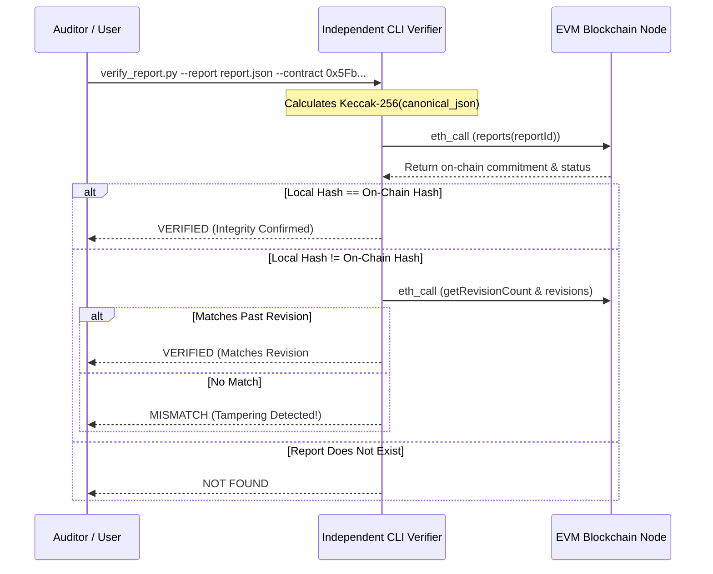

# AstraNexus Blockchain Threat Notary & Verification

## 1. Overview & Trust Philosophy

A central vulnerability of centralized security databases is **retroactive modification or deletion** of threat reports. A malicious actor, rogue administrator, or pressured authority could secretly alter evidence or remove confirmed threat records.

AstraNexus resolves this by committing cryptographic proofs of every threat report to an EVM-compatible blockchain. Anyone can independently verify that a report has remained untouched since its original timestamp without trusting AstraNexus servers.

---

## 2. Smart Contract Architecture (`ThreatRegistry.sol`)

The `ThreatRegistry` smart contract provides tamper-evident integrity tracking:

```solidity
// SPDX-License-Identifier: MIT
pragma solidity ^0.8.20;

contract ThreatRegistry {
    enum AttestationStatus { UNVERIFIED, CONFIRMED_THREAT, BENIGN_CLEARED, DISPUTED, REVOKED }

    struct ReportRecord {
        bytes32 reportId;
        bytes32 commitmentHash;
        uint256 initialTimestamp;
        address reporter;
        AttestationStatus status;
        uint256 disputeCount;
        bool exists;
    }

    struct Revision {
        bytes32 commitmentHash;
        uint256 timestamp;
        address revisedBy;
    }

    struct DisputeRecord {
        address disputer;
        bytes32 reasonHash;
        uint256 timestamp;
    }

    // Mapping from reportId to core record
    mapping(bytes32 => ReportRecord) public reports;
    // Mapping from reportId to revision history
    mapping(bytes32 => Revision[]) public reportRevisions;
    // Mapping from reportId to dispute logs
    mapping(bytes32 => DisputeRecord[]) public reportDisputes;

    event ReportRegistered(bytes32 indexed reportId, bytes32 indexed commitmentHash, address indexed reporter, uint256 timestamp);
    event ReportRevised(bytes32 indexed reportId, bytes32 newCommitmentHash, uint256 revisionIndex, address revisedBy, uint256 timestamp);
    event ReportDisputed(bytes32 indexed reportId, address indexed disputer, bytes32 reasonHash, uint256 timestamp);
    event AttestationUpdated(bytes32 indexed reportId, AttestationStatus newStatus, address attestor);
}
```

---

## 3. Cryptographic Commitment Calculation

### 3.1 Zero-PII Canonicalization
To guarantee privacy while ensuring deterministic reproducibility, the report is serialized into an exact canonical JSON structure before hashing:

```python
canonical_dict = {
    "report_id": str(report_id).strip(),
    "target_type": str(target_type).strip().upper(),
    "threat_category": str(threat_category).strip(),
    "risk_score": int(risk_score),
    "verdict": str(verdict).strip().upper(),
    "indicators_count": int(indicators_count),
    "evidence_digest": str(evidence_digest).strip().lower(),
    "salt": str(salt).strip().lower(),
}
canonical_json = json.dumps(canonical_dict, sort_keys=True, separators=(",", ":"))
commitment_hash = Web3.keccak(text=canonical_json).hex()
```

### 3.2 What Is Stored vs What Is Protected
| Parameter | On-Chain Commitment? | Reason |
| :--- | :---: | :--- |
| `report_id` | **Yes (bytes32)** | Unique identifier for querying and auditing. |
| `commitment_hash` | **Yes (bytes32)** | Keccak-256 digest binding all forensic fields. |
| `initialTimestamp` | **Yes (uint256)** | Block timestamp proving exact moment of record. |
| `reporter` | **Yes (address)** | Ethereum address of the notary signer. |
| `salt` | **Local Only** | 256-bit random entropy preventing rainbow table reversal. |
| `raw_url` | **NEVER** | Protects internal victims and unverified links. |
| `message_text` | **NEVER** | Zero-PII guarantee; protects credentials and privacy. |

---

## 4. Standalone Independent Verification (`tools/verify_report.py`)

AstraNexus provides a zero-backend-dependency verification CLI. It connects directly to the EVM RPC node via standard JSON-RPC `eth_call`.



### 4.1 CLI Verification Usage
```bash
# Verify canonical report JSON export
python tools/verify_report.py \
  --report verifiable_report.json \
  --rpc http://127.0.0.1:8545 \
  --contract 0x5FbDB2315678afecb367f032d93F642f64180aa3
```

### 4.2 Output Verdict Classifications
- **`VERIFIED`**: Report matches the on-chain commitment with mathematical certainty.
- **`MISMATCH`**: Local report parameters differ from the on-chain record (unauthorized tampering or corruption).
- **`NOT FOUND`**: No registration exists on the smart contract for this report ID.
- **`UNAVAILABLE`**: Blockchain RPC node is unreachable or network failed.
