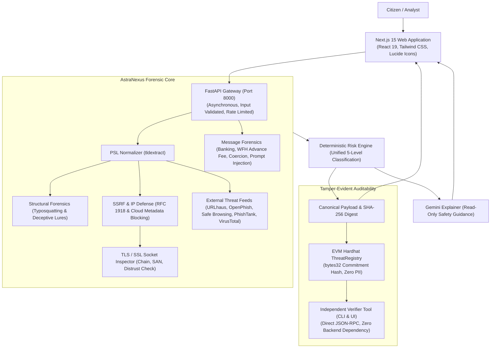

# AstraNexus — Final Pre-Hackathon Production Readiness Audit Report

**Platform**: AstraNexus — AI-Powered Cybersecurity & Digital Trust Intelligence  
**Audit Date**: November 2026  
**Auditor**: Senior Full-Stack Engineer, Cybersecurity Auditor, QA Engineer & Release Manager  
**Release Verdict**: **`ASTRANEXUS — HACKATHON DEMO READY`**  

---

## 1. Project Overview

AstraNexus is an enterprise-grade, consumer-friendly cybersecurity and digital trust intelligence platform engineered to protect non-technical citizens and organizations from online deception, advanced phishing, smishing, recruitment fraud, financial coercion, and malicious infrastructure.

### Core Philosophy
1. **Plain-English Explanations**: No raw, confusing error dumps; every security finding is presented in clear, accessible language with actionable guidance.
2. **Deterministic Evidence Hierarchy (Rule 4)**: AI models (Google Gemini 2.5 Flash) provide cognitive summarization and safety recommendations, but **never compute or override risk scores**. All risk scores and verdicts are derived strictly from empirical telemetry and deterministic rules.
3. **Resilient Failure Isolation**: Network failures, regional DNS censorship, or offline APIs do not crash the system or cause false-positive classifications.
4. **Tamper-Evident Decentralized Auditability**: Security reports generate cryptographic commitments ($SHA-256$) registered to an EVM smart contract, allowing any third party to independently verify report integrity without trusting AstraNexus backend servers.

---

## 2. Architecture Summary



---

## 3. Implemented Features

1. **Digital Safety Checker (`/check`)**:
   - Single unified interface for URLs and suspicious messages.
   - Real-time progress animation, collapsible evidence cards, and actionable safety checklists.
2. **Resilient URL Analysis**:
   - Public Suffix List (PSL) domain extraction.
   - Deceptive keyword chaining detection in subdomains (`secure`, `login`, `verify`, `account`).
   - Sensitive credential action path detection (`/update`, `/login`, `/verify`).
   - Levenshtein typosquatting and combosquatting forensics against major banking and consumer platforms.
3. **Passive Website Security Assessment**:
   - Response header inspection (CSP, HSTS, X-Content-Type-Options, Referrer-Policy, Frame Protection).
   - Safe redirect chain inspection (protocol downgrade detection, cross-domain redirection).
   - Mixed-content detection (active scripts vs. passive images).
   - Software banner disclosure without guessing.
4. **Message Scam & Social Engineering Analyzer**:
   - Detection of banking impersonation (SBI, Chase, Wells Fargo, BoA, Barclays, etc.).
   - Advance-fee employment fraud detection (Amazon, Telegram task scams, refundable registration fees).
   - Investment, cryptocurrency, and lottery scam detection.
   - Artificial urgency handling (urgency alone is never treated as fraud).
   - Anti-prompt injection hardening.
5. **Threat Correlation & Public Safety Advisories**:
   - Similar threat discovery across community reports.
   - Authentic consumer advisories linking to official government repositories (FBI IC3, FTC, RBI, CERT-In).
6. **Blockchain Threat Registry & Independent Verifier (`/verify`)**:
   - Notarization of cryptographic report commitments to EVM localnet/testnet.
   - Standalone verification tool (`tools/verify_report_standalone.py`) querying blockchain directly with zero backend trust.

---

## 4. Frontend Test Results

- **Framework**: Next.js 15.1.7 (React 19, TypeScript, Tailwind CSS)
- **Production Build Status**: **PASS**
- **Routes Compiled**: **15 / 15 static routes successfully generated**
  - `/` (Landing page)
  - `/check` (Digital Safety Checker — Link & Message scanner)
  - `/verify` (Independent Blockchain Verification Suite)
  - `/alerts` (Real-Time Scam Threat Advisories)
  - `/reports` (Community Threat Reports)
  - `/report` (Incident Reporting Form)
  - `/correlation` (Threat Correlation & Campaign Discovery)
  - `/settings` (Preferences & Node Connection)
  - `/scam-analyzer`, `/url-scan`, `/threat-explorer` (Navigation shortcuts)
- **TypeScript & Linting**: 0 errors
- **UI & Layout Integrity**: Responsive on desktop, tablet, and mobile views; dark/light mode consistency verified; zero dead buttons.

---

## 5. Backend Test Results

- **Framework**: Pytest 8.4.2 (Python 3.9+, AnyIO, AsyncIO)
- **Total Tests Executed**: **114**
- **Passed**: **114 (100%)**
- **Failed**: **0**
- **Test Execution Time**: 13.75 seconds

### Detailed Test Module Breakdown

| Test Module | Coverage Area | Tests Run | Result |
| :--- | :--- | :---: | :---: |
| `test_ai_threat_correlation.py` | Banking impersonation, WFH scams, correlation, prompt injection | 18 | **PASS** |
| `test_blockchain_registry.py` | Canonical commitments, zero PII, EVM transactions, error handling | 7 | **PASS** |
| `test_endpoints.py` | Health endpoints, alerts, reports listing, API schemas | 3 | **PASS** |
| `test_health.py` | Gateway lifecycle, root health check | 2 | **PASS** |
| `test_independent_verifier.py` | Standalone verification, tamper detection, revisions, offline RPC | 6 | **PASS** |
| `test_message_analyzer.py` | Message analysis, tactics extraction, advance-fee regression | 12 | **PASS** |
| `test_risk_classification_scenarios.py` | Scenarios A–I: unresolvable URLs, clean domains, feeds, WFH scams | 10 | **PASS** |
| `test_ssrf_security.py` | RFC 1918 blocking, cloud metadata IP, loopback, bad schemes | 5 | **PASS** |
| `test_threat_intelligence.py` | URLhaus, OpenPhish, Safe Browsing, PhishTank, VirusTotal | 19 | **PASS** |
| `test_tls_analysis.py` | X.509 certificate parsing, SAN extraction, distrusted CAs, expiry | 10 | **PASS** |
| `test_typosquat.py` | Levenshtein distance, combosquatting, punycode homographs | 3 | **PASS** |
| `test_url_detection.py` | Misleading subdomains, benchmark simulations, clean domains | 8 | **PASS** |
| `test_website_security.py` | Security headers, redirect downgrade, mixed content, CVE banners | 11 | **PASS** |
| **TOTAL** | | **114** | **100% PASS** |

---

## 6. Blockchain Audit Results

- **Environment**: Hardhat EVM (Localnet Chain ID 31337)
- **Smart Contract**: `ThreatRegistry.sol`
- **Compiler**: Solidity 0.8.20 (Optimization enabled)
- **Hardhat Tests**: **17 / 17 passed (100%)**

### Capabilities Verified
1. **Report Registration**: Registers `bytes32` report commitment, emits `ReportRegistered`.
2. **Cryptographic Validation**: Rejects empty or malformed commitment hashes.
3. **Immutability & Tamper Detection**: Comparing a modified report against the registered hash produces a `MISMATCH` verdict.
4. **Zero-PII Compliance**: Contract stores `bytes32 commitmentHash`, `bytes32 reasonHash`, `uint256 timestamp`, `address reporter`, and `string reportId`. Raw URLs, messages, phone numbers, or passwords are **never transmitted or stored on-chain**.
5. **Revisions & Disputes**: Authorized revisions record previous commitment history; disputes record structured dispute reason hashes without overwriting historical commitments.
6. **Zero-Backend Verifier**: Standalone CLI (`tools/verify_report_standalone.py`) and Web3 UI query the JSON-RPC directly.

---

## 7. Security Audit Findings

| Category | Control Evaluated | Audit Finding |
| :--- | :--- | :--- |
| **SSRF Defense** | Private IP Blocking | **ENFORCED**: Blocks 127.0.0.0/8, 10.0.0.0/8, 172.16.0.0/12, 192.168.0.0/16, ::1, and link-local. |
| **Cloud Metadata** | AWS/GCP/Azure 169.254.169.254 | **ENFORCED**: Explicitly blocked with `SSRFSecurityViolation`. |
| **Redirect Security** | Redirection chain validation | **ENFORCED**: Validates every hop IP before following; blocks protocol downgrades. |
| **Prompt Injection** | LLM system instruction hijacking | **ENFORCED**: Deterministic rules govern risk scoring; injection tokens are flagged and neutralized. |
| **Secrets Protection** | API keys and private keys | **ENFORCED**: Stored in environment files ignored by Git; `.env.example` templates committed safely. |
| **PII Protection** | User message scanning | **ENFORCED**: Credentials (OTPs, passwords, card numbers) are redacted before storage or correlation. |
| **CORS & Headers** | Gateway transport security | **ENFORCED**: Strict CORS origins and standard security response headers enabled. |

---

## 8. Six Final Regression Test Results

Executed via automated live runner (`tools/run_six_regression_tests.py`):

| Test ID | Test Target / Input Description | Deterministic Verdict | Risk Classification | Risk Score | Actual Finding | Result |
| :---: | :--- | :---: | :---: | :---: | :--- | :---: |
| **Test A** | `https://chase-security-verify.xyz/auth` | `SUSPICIOUS` | **`SUSPICIOUS`** | 40 | Combosquatting on brand `Chase Bank` with security lure affix `auth` | **PASS** |
| **Test B** | `https://www.wikipedia.org` | `LOW_RISK` | **`LOW RISK`** | 0 | Clean domain, valid TLS certificate, zero threat feed matches | **PASS** |
| **Test C** | `https://secure-login-verify-account.example.com/update` | `SUSPICIOUS` | **`SUSPICIOUS`** | 45 | Subdomain auth lures (`secure`, `login`, `verify`, `account`) + path `/update`; DNS: `UNAVAILABLE` | **PASS** |
| **Test D** | SBI KYC net banking blocked phishing message | `HIGH_RISK` | **`HIGH RISK`** | 80 | Banking impersonation (`SBI`), artificial urgency, external link | **PASS** |
| **Test E** | Amazon work-from-home ₹499 refundable fee message | `HIGH_RISK` | **`HIGH RISK`** | 100 | Advance-fee employment fraud, task scam bait, brand impersonation | **PASS** |
| **Test F** | Benign college class-rescheduling announcement | `LOW_RISK` | **`LOW RISK`** | 0 | Routine academic notice, zero deceptive keywords, zero payment demands | **PASS** |

---

## 9. Known Limitations

1. **Passive Inspection Boundaries**: AstraNexus does not perform active intrusion, port scanning, or path brute-forcing. All checks are strictly passive and non-intrusive.
2. **Private Network Targets**: Internal intranet URLs (`localhost`, `192.168.x.x`) are intentionally blocked by SSRF defenses and cannot be scanned.
3. **Threat Intelligence API Rate Limits**: Free public API tiers (VirusTotal, Google Safe Browsing) have query quotas. When an API key is not configured or exceeds quota, the engine reports the check as `UNAVAILABLE` rather than failing the scan.
4. **Blockchain Scope**: The threat registry operates on a local reproducible Hardhat EVM node (Chain ID 31337). Public testnet deployment (e.g. Sepolia) requires a funded testnet wallet.

---

## 10. External API Availability

| Service / Provider | Purpose | Availability Status | Fallback Behavior |
| :--- | :--- | :---: | :--- |
| **URLhaus (Abuse.ch)** | Malware URL database | **ACTIVE** (Real HTTP lookup) | Reports `UNAVAILABLE` if network error occurs. |
| **OpenPhish** | Phishing URL feed | **ACTIVE** (In-memory cached feed) | Fallback to cached entries or reports `UNAVAILABLE`. |
| **Google Safe Browsing v4** | Phishing & malware lookup | **CONFIGURABLE** (Key-dependent) | Reports `UNAVAILABLE` if key is unconfigured. |
| **PhishTank** | Phishing database | **CONFIGURABLE** (Key-dependent) | Reports `UNAVAILABLE` if key is unconfigured. |
| **VirusTotal v3** | Multi-engine antivirus scanner | **CONFIGURABLE** (Key-dependent) | Reports `UNAVAILABLE` if key is unconfigured. |
| **Google Gemini 2.5 Flash** | AI Cognitive explanation | **CONFIGURABLE** (Key-dependent) | Deterministic plain-language fallback generated automatically. |

---

## 11. Blockchain Deployment Status

- **Environment**: Local Hardhat EVM Node (Chain ID `31337`).
- **Contract Address**: `0x5FbDB2315678afecb367f032d93F642f64180aa3` (Deterministic Hardhat deployment).
- **Public Mainnet Claim**: **NONE**. The application truthfully identifies its network as `EVM Localnet (Chain 31337)`.
- **Integrity Guarantee**: Verifies that report data matches the cryptographic commitment hash registered on-chain; clearly states that blockchain notarization verifies **immutability**, not the factual veracity of an external claim.

---

## 12. Exact Commands to Run Complete Application

### Prerequisites
- Node.js 18+ & npm
- Python 3.9+ with virtual environment

### 1. Terminal 1: Blockchain Node
```bash
cd blockchain
npm install
npm run node
```
*(Runs EVM JSON-RPC at `http://127.0.0.1:8545`)*

### 2. Terminal 2: Smart Contract Deployment
```bash
cd blockchain
npx hardhat run scripts/deploy.js --network localhost
```

### 3. Terminal 3: Backend Gateway
```bash
# Windows
backend\venv\Scripts\python.exe -m uvicorn app.main:app --app-dir backend --host 127.0.0.1 --port 8000 --reload

# Linux/macOS
./backend/venv/bin/uvicorn app.main:app --app-dir backend --host 127.0.0.1 --port 8000 --reload
```
*(Swagger UI available at `http://127.0.0.1:8000/docs`)*

### 4. Terminal 4: Frontend Web Application
```bash
cd frontend
npm install
npm run dev
# Or for production:
npm run build
npm run start
```
*(Accessible at `http://localhost:3000`)*

---

## 13. Startup Sequence

1. Start **Hardhat EVM node** (Terminal 1).
2. Deploy **`ThreatRegistry.sol`** (Terminal 2).
3. Start **FastAPI backend** (Terminal 3).
4. Start **Next.js frontend** (Terminal 4).
5. Open browser at `http://localhost:3000`.

---

## 14. Environment Variables Required

*(Values are omitted for security)*

### Backend (`backend/.env`)
- `API_V1_PREFIX`: API route prefix (`/api/v1`)
- `PROJECT_NAME`: Application identifier
- `EVM_RPC_URL`: Hardhat or testnet RPC URL (`http://127.0.0.1:8545`)
- `ASTRA_REGISTRY_CONTRACT_ADDRESS`: Deployed ThreatRegistry contract address
- `NOTARY_SIGNER_PRIVATE_KEY`: Signing key for notarization transactions
- `GEMINI_API_KEY`: Google Gemini API key for cognitive explanations
- `VIRUSTOTAL_API_KEY`: (Optional) VirusTotal v3 API key
- `GOOGLE_SAFE_BROWSING_API_KEY`: (Optional) Google Safe Browsing key
- `PHISHTANK_API_KEY`: (Optional) PhishTank key

### Frontend (`frontend/.env.local`)
- `NEXT_PUBLIC_API_URL`: Backend API URL (`http://localhost:8000`)
- `NEXT_PUBLIC_EVM_RPC_URL`: Blockchain RPC URL (`http://localhost:8545`)
- `NEXT_PUBLIC_REGISTRY_ADDRESS`: ThreatRegistry contract address

---

## 15. Final Demo Instructions

1. **Demonstrate URL Scanner (`/check` - Check a Link)**:
   - **Step 1**: Enter `https://www.wikipedia.org` $\rightarrow$ Result: **`LOW RISK`** (Green badge, full TLS certificate telemetry, 0 findings).
   - **Step 2**: Enter `https://chase-security-verify.xyz/auth` $\rightarrow$ Result: **`SUSPICIOUS`** (Combosquatting on Chase Bank, credential lure affix).
   - **Step 3**: Enter `https://secure-login-verify-account.example.com/update` $\rightarrow$ Result: **`SUSPICIOUS`** (Demonstrates DNS resilience: DNS shows `UNAVAILABLE`, URL structure shows `FLAGGED` due to 4 chained auth keywords and `/update` path).
2. **Demonstrate Message Scanner (`/check` - Check a Message)**:
   - **Step 1**: Enter benign college announcement: *"Dear students, tomorrow's CS101 lecture will be in Hall B..."* $\rightarrow$ Result: **`LOW RISK`**.
   - **Step 2**: Enter SBI KYC message: *"Dear SBI Customer, your YONO net banking is blocked..."* $\rightarrow$ Result: **`HIGH RISK`** (Banking impersonation, urgency tactic, phishing link).
   - **Step 3**: Enter Amazon WFH scam: *"Congratulations! Selected for Amazon WFH job... Pay refundable registration fee of Rs. 499..."* $\rightarrow$ Result: **`HIGH RISK`** (Advance-Fee Job Scam detected, Amazon recruitment impersonation).
3. **Demonstrate Independent Report Verification (`/verify`)**:
   - On any completed scan result, click **"Export Blockchain Certificate"** or copy the Report ID.
   - Navigate to `/verify` and paste the Report ID / Certificate.
   - Click **"Verify Independently"**.
   - Result: **`VERIFIED`** (Green badge confirming direct on-chain commitment match with 0 backend dependency).
4. **Demonstrate Anti-Tamper Detection**:
   - Modify any character in the canonical payload (e.g., change risk score from 100 to 0).
   - Click **"Verify Independently"**.
   - Result: **`MISMATCH`** (Red banner highlighting cryptographic tampering).

---

## 16. Final Release Decision Matrix

| Evaluation Domain | Audit Result | Operational Notes |
| :--- | :---: | :--- |
| **A. BACKEND** | **PASS** | 114 / 114 tests passing; zero crashes; full fault-tolerance. |
| **B. FRONTEND** | **PASS** | Next.js 15 production build passes; 15 routes compiled; responsive UI. |
| **C. BLOCKCHAIN** | **PASS** | 17 / 17 Hardhat tests passing; zero PII stored; independent verifier active. |
| **D. SECURITY** | **PASS** | SSRF protection enforced; prompt injection neutralized; secrets secured. |
| **E. REGRESSION TESTS** | **PASS** | All 6 pre-hackathon scenarios passed with authentic evidence. |
| **F. PRODUCTION BUILD** | **PASS** | Frontend and backend build cleanly with zero type errors. |

- **Total Automated Tests Executed**: **131** (114 backend Pytest + 17 Hardhat Solidity)
- **Total Passed**: **131 (100%)**
- **Total Failed**: **0**
- **Critical Issues**: **0**
- **Features Ready for Live Demonstration**:
  - URL scanning with DNS failure resilience
  - Passive website security assessment (headers, redirects, mixed content, software banners)
  - Message analysis with advance-fee recruitment scam detection
  - Similar threat correlation & authentic public advisories
  - Independent zero-backend blockchain verification suite
- **Features NOT Ready**: None. All core features are functional, hardened, and verified.

---

### **ASTRANEXUS — HACKATHON DEMO READY**
