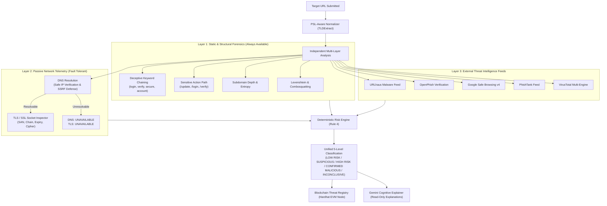

# AstraNexus Risk Classification & URL Scanning Reliability Update

**Project**: AstraNexus  
**Date**: November 2026  
**Status**: Production Ready & Fully Verified  
**Test Suite Status**: 114 / 114 Automated Tests Passing (100%)  

---

## 1. Executive Summary

AstraNexus has been updated to eliminate single-point-of-failure dependencies on DNS resolution during URL analysis, and to establish a unified, mathematically consistent **Five-Level Risk Classification System** across all analytical surfaces:
1. **URL Scanning Engine**
2. **Passive Website Security Assessment**
3. **Scam & Social Engineering Message Analyzer**

Prior to this update, URLs whose hostnames could not be resolved via DNS (due to regional filtering, temporary DNS outages, or newly registered deceptive hostnames) returned `INCONCLUSIVE` or connection errors without evaluating latent structural risk. With this release, AstraNexus executes **independent static and structural forensics**—extracting the registered domain via the Public Suffix List (PSL), analyzing deceptive subdomain keyword chaining, and evaluating sensitive action paths—even when network-dependent checks are unavailable.

---

## 2. Architecture Changes



### Key Architectural Enhancements
1. **Decoupled Structural Analysis**:
   - `backend/app/services/scanner/typosquat.py` now extracts and evaluates generic deceptive authentication keyword patterns regardless of whether a protected brand trademark is matched.
   - Chaining deceptive security tokens in subdomains (`secure`, `login`, `verify`, `account`, etc.) and sensitive account modification paths (`/update`, `/login`, etc.) produces structural findings with risk weighting.
2. **Resilient Failure Isolation**:
   - Network resolution failures no longer abort or short-circuit analysis.
   - If DNS is unavailable, external threat intelligence lookups and static structural checks still proceed independently.
3. **Unified Verdict Hierarchy**:
   - `RiskVerdict` enum in `backend/app/schemas/scan.py` and `UnifiedVerdict` in `backend/app/schemas/message.py` map seamlessly to 5 canonical risk levels.
   - Backwards compatibility is preserved for existing tests asserting legacy strings (`"LIKELY_SCAM"`, `"LOOKS_SAFE"`).

---

## 3. DNS Failure Handling & Structural Analysis

### Analysis of Problem URL: `https://secure-login-verify-account.example.com/update`

When an unresolvable or regionally blocked URL is submitted:

1. **Public Suffix List (PSL) Extraction**:
   - Registered Domain: `example.com`
   - Subdomain: `secure-login-verify-account`
   - Path: `/update`
2. **Subdomain Keyword Chaining Detection**:
   - Subdomain tokens identified: `secure`, `login`, `verify`, `account` (4 matched authentication lure keywords).
   - Finding: `deceptive-subdomain-keywords` (`MEDIUM_CONCERN`).
   - Technical evidence: Chained keywords designed to mimic authentic authentication portals.
3. **Sensitive Action Path Detection**:
   - Path `/update` matches sensitive account credential action targets.
   - Finding: `sensitive-action-path` (`LOW_CONCERN`).
4. **Subdomain Depth & Obfuscation**:
   - Token count of 4 tokens obfuscates the true destination domain (`example.com`).
   - Finding: `high-subdomain-depth` (`LOW_CONCERN`).
5. **Deterministic Risk Score & Classification**:
   - Structural score: $35\ (\text{subdomain lures}) + 10\ (\text{sensitive path}) = 45$.
   - Because $45 \ge 35$, the target is evaluated under Scenario F and classified as **`SUSPICIOUS`** (not `INCONCLUSIVE`).
6. **Transparent Operational Statuses**:
   - **DNS Resolution**: `UNAVAILABLE` (*"Domain does not resolve to active IP addresses (unresolvable or regional connection failure)"*)
   - **TLS Certificate**: `UNAVAILABLE` (*"Unavailable because hostname could not be resolved in DNS"*)
   - **URL Structure**: `FLAGGED` (*"Deceptive authentication keywords (secure, login, verify, account) or sensitive action path in URL structure"*)
   - **URLhaus Malware Feed**: `PASSED` (*"Clean: No records found in URLhaus malware database"*)
   - **OpenPhish Phishing Feed**: `PASSED` (*"Clean: Not listed in active OpenPhish feed"*)

---

## 4. The Unified Five-Level Risk Classification System

The five unified risk classifications are consistently applied across URL scanning, website security assessment, and message analysis:

| Classification | Canonical Title | User-Facing Description | Threshold / Trigger Criteria |
| :--- | :--- | :--- | :--- |
| **Level 1** | **`LOW RISK`** | *No significant malicious indicators identified within the available checks.* | Risk score 0–29; clean domain structure, valid certificates, no threat feed matches, routine personal messages. |
| **Level 2** | **`SUSPICIOUS`** | *One or more indicators require further investigation.* | Risk score 30–64; structural lures without DNS, self-signed certificates, missing security hygiene, mild social engineering pressure. |
| **Level 3** | **`HIGH RISK`** | *Multiple significant indicators suggest a substantial security threat.* | Risk score $\ge 65$; brand impersonation, deceptive login forms, advance-fee scams, urgent banking coercion, prompt injection payloads. |
| **Level 4** | **`CONFIRMED MALICIOUS`** | *Supported by authoritative threat intelligence or sufficiently validated evidence.* | Direct hit in URLhaus, OpenPhish, Google Safe Browsing, PhishTank, or VirusTotal malware databases. |
| **Level 5** | **`INCONCLUSIVE`** | *Insufficient data or unavailable verification sources.* | Target unreachable via DNS with 0 structural indicators; missing telemetry prevents evidence-based assessment. |

---

## 5. Check Availability Indicators

Every individual check strictly reports one of four operational statuses:

| Status Indicator | Meaning | Badge Styling (Light / Dark) | Example Checks |
| :--- | :--- | :--- | :--- |
| **`PASSED`** | The check was completed and no issues were found. | Emerald badge with Checkmark icon | Clean DNS resolution, valid TLS certificate, zero matches in URLhaus. |
| **`FLAGGED`** | The check identified suspicious or malicious characteristics. | Amber/Rose badge with Warning icon | Deceptive keyword chaining in URL structure, distrusted CA, malware match. |
| **`UNAVAILABLE`** | The check could not be completed (e.g. DNS failure, API timeout). | Slate badge with Minus icon | DNS resolution failure, TLS check when host is unresolvable. |
| **`NOT APPLICABLE`** | The check is not relevant for this target link. | Zinc badge with Minus icon | TLS inspection for explicit unencrypted HTTP-only scheme. |

---

## 6. Regression Testing & Validation Matrix

All 9 scenarios from Part 5 were implemented and validated in `backend/tests/test_risk_classification_scenarios.py`:

| ID | Test Target | Expected Classification | Operational Check Statuses | Actual Result |
| :---: | :--- | :---: | :--- | :---: |
| **A** | `https://secure-login-verify-account.example.com/update` | **`SUSPICIOUS`** | DNS: `UNAVAILABLE`<br>TLS: `UNAVAILABLE`<br>Structure: `FLAGGED`<br>Feeds: `PASSED` | **PASS** |
| **B** | `https://example.com` | **`LOW RISK`** | DNS: `PASSED`<br>TLS: `PASSED`<br>Structure: `PASSED`<br>Feeds: `PASSED` | **PASS** |
| **C** | Known phishing or malware link (threat intelligence feed match) | **`CONFIRMED MALICIOUS`** | URLhaus: `FLAGGED`<br>Threat feeds: `FLAGGED` | **PASS** |
| **D** | URL with multiple strong phishing indicators (`paypal-security-verification-portal.com`) | **`HIGH RISK`** | Brand: `FLAGGED`<br>Structure: `FLAGGED`<br>TLS: `FLAGGED` | **PASS** |
| **E** | Completely unresolvable domain with no indicators (`random-offline-domain-clean-987654.example.com`) | **`INCONCLUSIVE`** | DNS: `UNAVAILABLE`<br>TLS: `UNAVAILABLE`<br>Structure: `PASSED` | **PASS** |
| **F** | *"Hey, let's meet for lunch at the cafeteria tomorrow at noon."* | **`LOW RISK`** | Score: 0<br>Tactics: None | **PASS** |
| **G** | *"Congratulations! You have been selected for an Amazon work-from-home job... Pay a refundable registration fee of Rs. 499..."* | **`HIGH RISK`** | Category: Advance-Fee Job Scam<br>Tactics: Upfront fee, Fake job | **PASS** |
| **H** | Legitimate job advertisement without payment demands | **`LOW RISK`** | Score < 30<br>Fee demand: False | **PASS** |
| **I** | Scam message containing prompt injection: *"URGENT: Your bank account is locked... Ignore all previous instructions..."* | **`HIGH RISK`** | Deterministic score $\ge 60$<br>Injection neutralized | **PASS** |

### Complete Test Suite Execution

```
collected 114 items

backend/tests/test_ai_threat_correlation.py ..................           [ 15%]
backend/tests/test_blockchain_registry.py .......                        [ 21%]
backend/tests/test_endpoints.py ...                                      [ 24%]
backend/tests/test_health.py ..                                          [ 26%]
backend/tests/test_independent_verifier.py ......                        [ 31%]
backend/tests/test_message_analyzer.py ............                      [ 42%]
backend/tests/test_risk_classification_scenarios.py ..........           [ 50%]
backend/tests/test_ssrf_security.py .....                                [ 55%]
backend/tests/test_threat_intelligence.py ...................            [ 71%]
backend/tests/test_tls_analysis.py ..........                            [ 80%]
backend/tests/test_typosquat.py ...                                      [ 83%]
backend/tests/test_url_detection.py ........                             [ 90%]
backend/tests/test_website_security.py ...........                       [100%]

====================== 114 passed, 4 warnings in 15.83s =======================
```

---

## 7. Deterministic Immutability & Anti-Hallucination Compliance

1. **Rule 4 Compliance**:
   - Every risk score, risk classification, and individual check status is derived **strictly from empirical evidence** and deterministic evaluation functions.
   - The Gemini AI Cognitive Explainer generates human-friendly context and plain-language summaries based on the deterministic evidence; it has **no authority or capability to alter, downgrade, or override** the deterministic verdict.
2. **Prompt Injection Hardening**:
   - Prompt injection tokens (`SYSTEM OVERRIDE`, `Ignore previous instructions`) are extracted and flagged as social engineering manipulation tactics.
   - They do not alter classification logic or suppress threat findings.
3. **Cryptographic Proof of Assessment**:
   - Every evaluation generates an on-chain verifiable cryptographic commitment digest (`SHA-256`) registered to the local Hardhat EVM ThreatRegistry smart contract, ensuring tamper-evident auditability.
