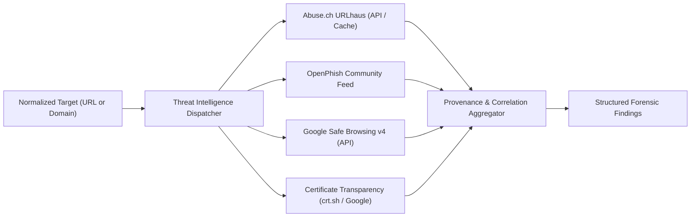

# AstraNexus Threat Intelligence & Correlation Engine

## 1. Overview & Forensic Principle

AstraNexus integrates real-world external threat intelligence feeds and official government consumer advisories with strict attribution.

**Strict Honesty Guarantee**:
- Threat intelligence hits are never simulated or fabricated.
- When an API key is missing or an external provider is unreachable, AstraNexus explicitly returns `FEED_UNAVAILABLE` or `INCONCLUSIVE` rather than fabricating a false match.
- Source provenance is preserved for every indicator (Provider, Timestamp, Reference URL, Match Type).

---

## 2. Integrated Threat Intelligence Sources

### 2.1 Abuse.ch URLhaus
- **Capabilities**: Real-time malware distribution and phishing URL database.
- **Query Mechanism**:
  1. Full URL lookup: `POST /v1/url/` with normalized target URL.
  2. Domain fallback: `POST /v1/host/` for domain-level infrastructure matching.
- **Telemetry Recorded**: URLhaus ID, threat type, malware payload tags, blacklists (Spamhaus, SURBL), and submission timestamp.

### 2.2 OpenPhish Community Feed
- **Capabilities**: High-confidence real-time phishing feed updated hourly.
- **Query Mechanism**: Evaluates exact normalized URL and domain against an in-memory TTL-cached feed (`FEED_CACHE_TTL_SECONDS = 3600`).
- **Telemetry Recorded**: Match status, discovery timestamp, target brand.

### 2.3 Google Safe Browsing v4
- **Capabilities**: Global enterprise threat directory for social engineering, malware, and unwanted software.
- **Query Mechanism**: `threatMatches:find` using normalized client URL.
- **Telemetry Recorded**: Threat type (`SOCIAL_ENGINEERING`, `MALWARE`), platform type (`ANY_PLATFORM`), cache duration.

### 2.4 Certificate Transparency (CT) Logs
- **Capabilities**: Public cryptographic ledger of all issued TLS certificates.
- **Telemetry Recorded**: Certificate issuance history, SAN diversity, anomalous subdomains, and CA authenticity.

---

## 3. URL Normalization Architecture

Before performing lookups across disparate intelligence databases, URLs undergo canonical normalization:
1. **Scheme Standardization**: Defaults to `https://` if omitted.
2. **Case Normalization**: Hostname and domain components are converted to lowercase.
3. **Punycode Decoding**: IDN homograph domains (e.g. `xn--pypal-4ve.com`) are decoded to unicode for brand evaluation while preserving ascii for DNS.
4. **Trailing Slash & Port Cleanup**: Default ports (`:80`, `:443`) and redundant trailing slashes are sanitized.
5. **Dual-Tier Lookups**:
   - Primary: Exact URL matching (path-sensitive phishing).
   - Secondary: Domain and registered domain (ETLD+1) matching for broad infrastructure blocking.

---

## 4. Threat Correlation & Cluster Analysis (`threat_correlator.py`)

AstraNexus does not evaluate indicators in complete isolation. The Threat Correlator connects incoming submissions against known community incident patterns.

### 4.1 Correlation Match Types & Confidence
| Match Type | Description | Confidence |
| :--- | :--- | :---: |
| **EXACT_INDICATOR** | Identical URL, phone number, or crypto wallet observed in verified reports | **100%** |
| **DOMAIN_INFRASTRUCTURE** | Matches shared hostname, second-level domain, or root nameserver | **90%** |
| **SEMANTIC_SIMILARITY** | Shared phrasing, script keywords, and scam story arcs (Jaccard similarity >= 0.40) | **65% - 85%** |
| **SHARED_TECHNIQUE** | Matching manipulation tactics (e.g. Fake Job Offer + Advance Fee + Telegram handle) | **68%** |

### 4.2 Distinguishing Community Metrics
To prevent misleading inflation of report statistics, the system strictly separates:
- **Similar Reports Count**: Total related submissions across the platform.
- **Unique Reporters Count**: Number of distinct individuals reporting the threat.
- **Confirmed Incidents Count**: Number of reports verified by human security analysts or automated multi-source consensus (`VERIFIED_THREAT`).
- **Suspected Campaign**: Automated clustering of related indicators into named threat clusters (e.g., *"USPS Parcel Redelivery Phishing Ring"*).

---

## 5. Authentic Government & Consumer Advisories (Zero Fabrication)

To prevent LLM hallucinations of non-existent consumer warnings, AstraNexus maintains an authoritative library of genuine consumer protection advisories:

| Agency / Publisher | Advisory Title | Official Source |
| :--- | :--- | :--- |
| **Federal Trade Commission (FTC)** | How To Spot and Avoid Phishing Scams | [consumer.ftc.gov](https://consumer.ftc.gov/articles/how-spot-and-avoid-phishing-scams) |
| **Federal Trade Commission (FTC)** | Scammers Use Fake Job Offers to Steal Money | [consumer.ftc.gov](https://consumer.ftc.gov/consumer-alerts/2023/06/scammers-use-fake-job-offers) |
| **Federal Trade Commission (FTC)** | Fake Prize, Sweepstakes, and Lottery Scams | [consumer.ftc.gov](https://consumer.ftc.gov/articles/fake-prize-sweepstakes-lottery-scams) |
| **CISA** | Understanding and Mitigating Phishing Attacks | [cisa.gov](https://www.cisa.gov/news-events/cybersecurity-advisories) |
| **FBI IC3** | Decentralized Finance & Cryptocurrency Fraud Alert | [ic3.gov](https://www.ic3.gov/Media/Y2023/PSA230822) |
| **U.S. Postal Inspection Service (USPIS)** | Smishing: Package Tracking Text Scams | [uspis.gov](https://www.uspis.gov/news/scam-article/smishing-package-tracking-text-scams) |

Each advisory includes authentic title, verified publication date, original source URL, and a contextual explanation of its relevance to the detected scam pattern.
